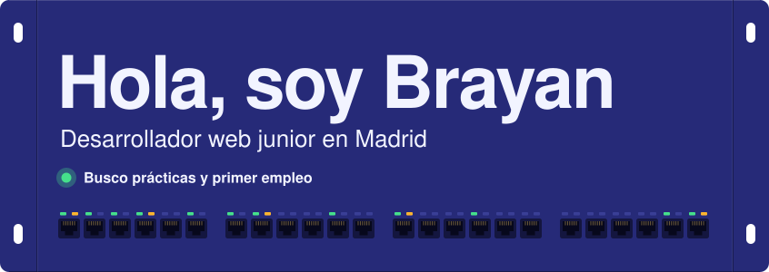
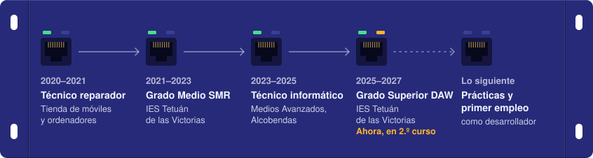

<picture>
  <source media="(max-width: 544px)" srcset="https://raw.githubusercontent.com/3r4yn/3r4yn/main/assets/banner-movil.svg">
  
</picture>

## Sobre mí

Estudio 2.º de DAW (Desarrollo de Aplicaciones Web) en el IES Tetuán de las Victorias, en Madrid. Antes hice allí el Grado Medio de SMR y trabajé dos años como técnico informático: configuraba routers y switches, montaba VPN y daba soporte a usuarios.

De esa etapa me quedo con una costumbre: no dejar un problema a medias. Ahora programo lo que antes solo conectaba, con PHP y Java en el servidor y JavaScript en el navegador.

- Busco empresa para las prácticas de DAW y mi primera oportunidad como desarrollador junior, backend o frontend
- Dos años de experiencia en sistemas y redes: VPN con WireGuard y OpenVPN, routers MikroTik, servidores Linux y Microsoft Azure
- Hablo español (nativo) e inglés (nivel medio)
- Vivo en Madrid y tengo disponibilidad inmediata

English version

 

I'm in my second year of DAW, a two-year web development degree, at IES Tetuán de las Victorias in Madrid. Before that I finished a vocational degree in systems and networks (SMR) at the same school and worked for two years as an IT technician: I configured routers and switches, set up VPNs and supported users.

That job left me with one habit: I don't leave a problem half solved. Now I write the software that runs on the networks I used to set up, with PHP and Java on the server and JavaScript in the browser.

- Looking for a company for my DAW internship and for my first role as a junior developer, backend or frontend
- Two years of experience with systems and networks: VPNs with WireGuard and OpenVPN, MikroTik routers, Linux servers and Microsoft Azure
- I speak Spanish (native) and English (intermediate)
- Based in Madrid and available immediately

## Mi camino

<picture>
  <source media="(max-width: 544px)" srcset="https://raw.githubusercontent.com/3r4yn/3r4yn/main/assets/mi-camino-movil.svg">
  
</picture>

## Tecnologías

El LED verde marca lo que ya uso. El ámbar, lo que estoy aprendiendo este curso.

**Backend y bases de datos**  

**Frontend**  

**Sistemas y redes**  

**Herramientas**  

## Proyectos

**[php-backend-daw](https://github.com/3r4yn/php-backend-daw)**, PHP y MySQL  
Un CRUD de productos con PDO, consultas preparadas y patrón Repository. Incluye un miniforo, ejercicios de sesiones y cookies, y generación de PDF con mPDF.

**[gestion-almacen-java](https://github.com/3r4yn/gestion-almacen-java)**, Java y Swing  
Aplicación de escritorio para llevar un almacén: altas, bajas, compras, ventas y aviso de stock mínimo. La ventana trabaja contra una interfaz de datos con dos implementaciones, ArrayList y HashMap.

**[ies-tetuan-web](https://github.com/3r4yn/ies-tetuan-web)**, HTML y CSS  
Web de mi instituto, con varias páginas y adaptada a móvil. Usa HTML semántico, CSS con nomenclatura BEM y cuida la accesibilidad. [Abrir la web](https://3r4yn.github.io/ies-tetuan-web/ies-tetuan/).

**[java-colecciones](https://github.com/3r4yn/java-colecciones)**, Java  
Ejercicios de colecciones aplicados a casos concretos: una biblioteca, un minidiccionario, un chatbot tipo Eliza y una carrera de coches con ventana gráfica.

## Este curso

- La parte del servidor con PHP: PDO, sesiones y programación orientada a objetos
- JavaScript en el navegador y mis primeros pasos con TypeScript
- Diseño de interfaces web accesibles y adaptadas a móvil
- Despliegue de aplicaciones web

## Contacto

Si tienes una vacante de prácticas o un puesto junior, escríbeme por LinkedIn.
